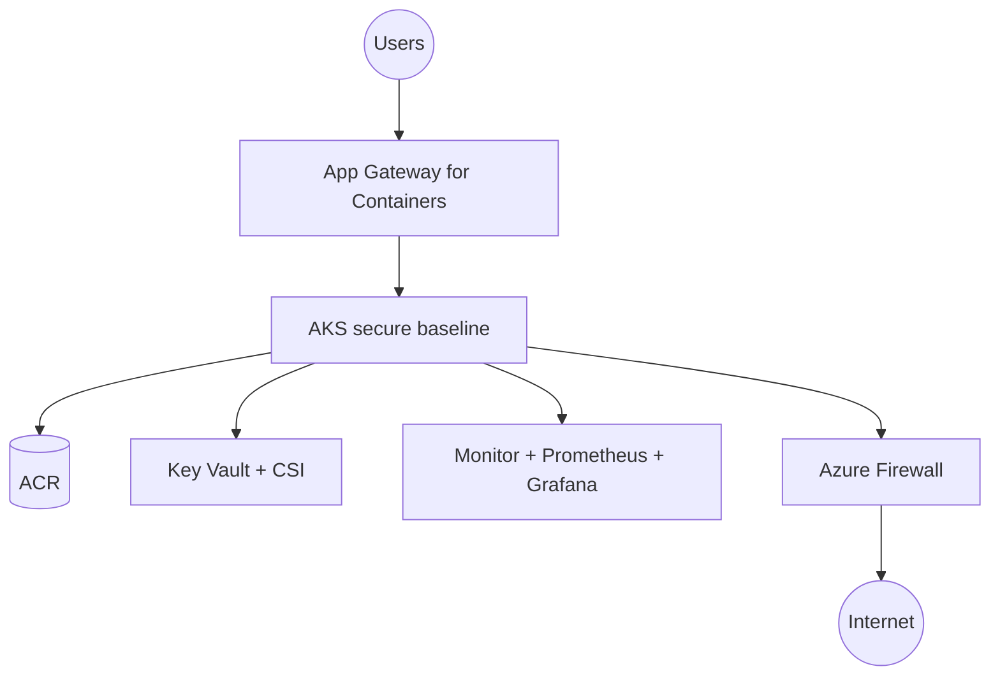

# As-Built — &lt;Customer A&gt; — AKS secure baseline

> B.4.1 / B.5.2 evidence. Export as `B4.1_AsBuilt_CustomerA_v1.pdf`. Anonymise; no secrets,
> subscription IDs, or tenant IDs.

| Field | Value |
|---|---|
| Customer | Customer A |
| Environment | prod / non-prod |
| Region(s) | westeurope |
| Delivered by / date | |
| Source HLD | `B3.1_SolutionDesign_CustomerA_v1` |

## 1. Cluster

| Property | Value |
|---|---|
| AKS K8s version | |
| Node image version | |
| Node pools (system/user, SKU, AZs, count) | |
| CNI | Azure CNI Overlay |
| Private cluster | yes/no |
| SLA tier | |

## 2. Networking

| Property | Value |
|---|---|
| VNet / subnets | |
| Egress | Azure Firewall (FQDN allow-list) |
| Ingress | App Gateway for Containers / NGINX |
| DNS / Private Link | |

## 3. Identity

| Property | Value |
|---|---|
| Entra integration | enabled |
| Azure RBAC for Kubernetes | enabled |
| Workload Identity federations | |

## 4. Platform services

| Service | Version / SKU | Notes |
|---|---|---|
| Azure Container Registry | | managed-identity pull |
| Key Vault + CSI Secret Store | | |
| Defender for Containers | | |
| Azure Policy for AKS | | Deployment Safeguards |
| Monitor / Managed Prometheus / Grafana | | |

## 5. GitOps state

| Flux object | Source revision | Path |
|---|---|---|
| Kustomization (cluster) | | `gitops/clusters/microhack` |
| HelmReleases (infra) | | `gitops/infrastructure` |
| App Kustomizations | | `gitops/apps` |

## 6. Workload versions

| Workload | Image | Tag/digest | Chart |
|---|---|---|---|
| dotnet-api | | | |
| python-worker | | | |
| node-web | | | |

## 7. Delta vs. HLD (B.3.1)

| Design area | HLD intent | As-built | Reason | Customer ack |
|---|---|---|---|---|
| | | | | |

## 8. Architecture diagram

