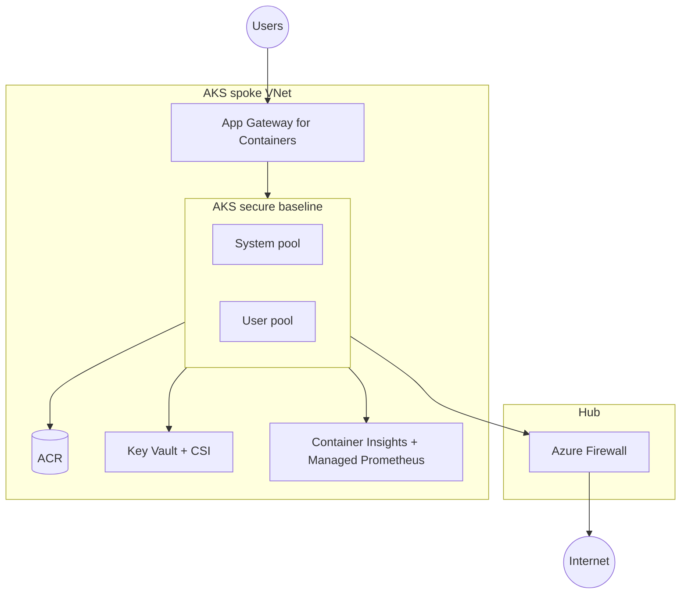

# AKS Landing-Zone HLD — &lt;Customer A&gt;

> B.3.1 Solution Design evidence. Do not delete design-area sections; mark `N/A (reason)` if out
> of scope. Export as `B3.1_SolutionDesign_CustomerA_v1.pdf`.

| Field | Value |
|---|---|
| Customer | Customer A (anonymised) |
| Author / date | |
| Reference architecture | AKS baseline / **secure baseline** / multi-region / ALZ accelerator |
| Region(s) | westeurope |
| Compliance regime | |

## 1. Executive summary

&lt;What is being built, for whom, and the headline architecture decisions.&gt;

## 2. Requirements

- Functional: &lt;…&gt;
- Non-functional (SLO, scale, residency, RTO/RPO): &lt;…&gt;
- Constraints & assumptions: &lt;…&gt;

## 3. Architecture overview

## 4. Design areas

> One subsection per area. State **Decision**, **Rationale**, **AVM module / AKS feature**,
> **Alternative considered**.

### 4.1 Identity & access

### 4.2 Network topology & connectivity

### 4.3 Cluster & node pools

### 4.4 Namespaces & multi-tenancy

### 4.5 Workload scheduling & resilience

### 4.6 Security & compliance

### 4.7 Secrets management

### 4.8 Storage & data

### 4.9 Observability & monitoring

### 4.10 Governance & cost

### 4.11 Business continuity / DR

### 4.12 CI/CD & GitOps

### 4.13 Container registry & supply chain

### 4.14 Platform lifecycle & currency

## 5. Decisions register (ADR-style)

| # | Decision | Options | Choice | Rationale | Consequences |
|---|---|---|---|---|---|
| 1 | | | | | |

## 6. Requirements traceability

| Requirement / B.2.1 remediation item | Design area | How satisfied |
|---|---|---|
| | | |

## 7. Well-Architected Review scope (feeds B.3.2)

- Pillars to review: **Reliability** + **Security** (default).
- Hand off to the `war-runner` skill.
