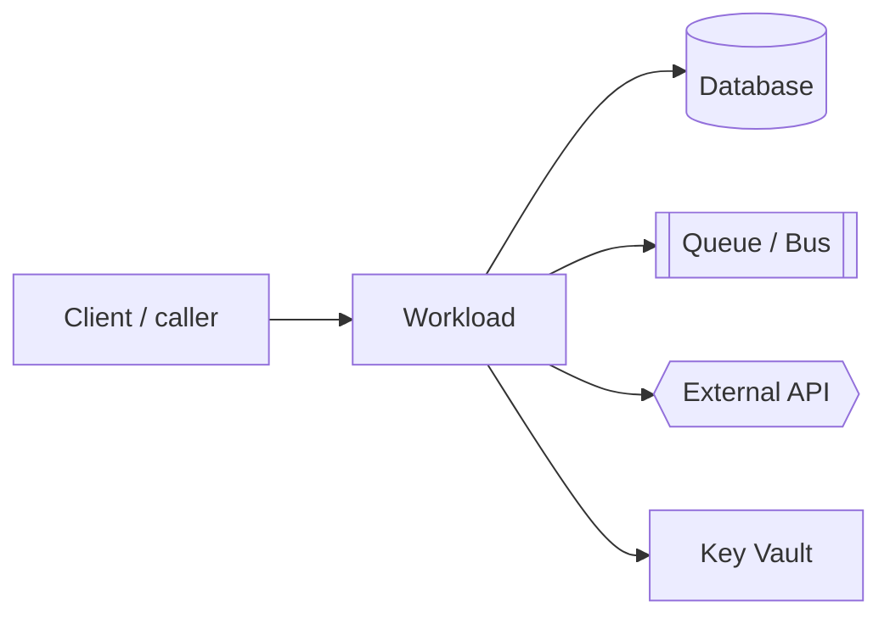

# Dependency map — &lt;Workload&gt; (Customer A)

> B.2.1 evidence. Anonymise customer names. Export the diagram to
> `B2.1_DependencyMap_CustomerA_v1.png`.

## Summary

- **Workload:** &lt;name&gt;
- **Runtime:** &lt;language / framework / version&gt;
- **Migration verdict:** Rehost | Replatform | Refactor
- **Top blockers:** &lt;1&gt;, &lt;2&gt;, &lt;3&gt;

## Topology

## Inbound

| Caller | Protocol / port | Auth | Notes |
|---|---|---|---|
| | | | |

## Outbound

| Dependency | Type | Protocol / endpoint | Auth | Egress (Firewall) rule |
|---|---|---|---|---|
| | | | | |

## Data stores

| Store | Engine | State class | Residency | Backup |
|---|---|---|---|---|
| | | | | |

## Identity & secrets

| Secret / credential | Current location | Target (Key Vault + CSI / Workload ID) |
|---|---|---|
| | | |

## AKS-readiness scorecard

| Dimension | RAG | Evidence | Remediation ref |
|---|---|---|---|
| Statelessness / 12-factor | | | |
| Containerisation | | | |
| Secrets | | | |
| Identity (Workload ID) | | | |
| Networking / egress | | | |
| Observability (OTel) | | | |
| Data | | | |
| Resilience (probes/PDB) | | | |
