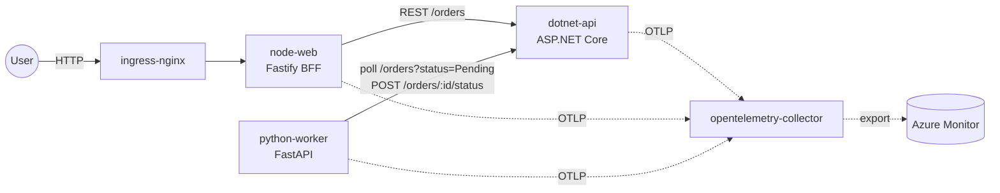

# `apps/` — Polyglot sample workloads

A small, realistic microservices set that the labs **assess → design → migrate → test →
operate**, exercising Module B end‑to‑end.

| Service | Stack | Role |
|---|---|---|
| `dotnet-api` | **.NET 10** / ASP.NET Core Minimal API | Public REST API (orders), exposes `/health` liveness + readiness, OpenAPI |
| `python-worker` | **Python 3.14** / FastAPI | Async worker/processor, queue consumer, metrics endpoint |
| `node-web` | **Node 24** / Fastify | Web BFF / front door calling the API, server‑rendered status page |

## Requirements
- **Distroless / Chiseled** multi‑stage Dockerfiles; non‑root; healthchecks.
- **OpenTelemetry** traces/metrics/logs → Azure Monitor (OTLP).
- Config via env + Key Vault CSI; **no secrets in images**.
- Helm chart **or** Kustomize base+overlays per service for AKS deploy.
- Latest dependencies, **zero known vulnerabilities**, permissive licenses only.

### Optional AI capability
If any service adds an AI endpoint, it must use a **modular inference provider**
abstraction supporting **Azure AI Foundry / Azure OpenAI / GitHub Models** (selectable via
config), per the course standing rules.

> Owned by workstream **WS2 (Apps)**.

## Architecture



## Service catalog

| Service | Stack | Container port | Key endpoints | Image (base name) |
|---|---|---|---|---|
| `dotnet-api` | .NET 10 Minimal API | 8080 | `/orders`, `/healthz`, `/readyz`, `/openapi/v1.json`, `/` (Scalar) | `dotnet-api` |
| `python-worker` | Python 3.14 FastAPI | 8080 | `/health`, `/metrics` (Prometheus) | `python-worker` |
| `node-web` | Node 24 Fastify | 8080 | `/` (SSR status page), `/health` | `node-web` |

## Shared conventions (all services)

- **Listen** on `0.0.0.0:8080`; Service exposes `80 -> 8080`.
- **Namespace** `microhack-apps` (the `gitops/apps/base` layer owns the `Namespace`).
- **OpenTelemetry** via standard env (`OTEL_SERVICE_NAME`, `OTEL_EXPORTER_OTLP_ENDPOINT`,
  `OTEL_EXPORTER_OTLP_PROTOCOL`); falls back to **Azure Monitor** when
  `APPLICATIONINSIGHTS_CONNECTION_STRING` is set; **no-ops** when nothing is configured
  (so unit tests run fully offline).
- **Config** from env + **Key Vault CSI** (`SecretProviderClass` projects secrets to env);
  no secrets baked into images.
- **Workload Identity**: each service has a `ServiceAccount` named after the service, labelled
  `azure.workload.identity/use: "true"` with a `client-id` annotation placeholder
  (`REPLACE_<SERVICE>_CLIENT_ID`) wired from infra federated-credential outputs.
- **Hardened pods**: non-root, `readOnlyRootFilesystem`, `allowPrivilegeEscalation: false`,
  all caps dropped, `seccompProfile: RuntimeDefault`, CPU/memory requests+limits, HPA (v2),
  liveness/readiness/startup probes.
- **Containers**: multi-stage, distroless/chiseled, non-root, with a `HEALTHCHECK`.
  - `dotnet-api`: `mcr.microsoft.com/dotnet/aspnet:10.0-noble-chiseled` (uid 1654)
  - `python-worker`: `cgr.dev/chainguard/python:latest` distroless (uid 65532)
  - `node-web`: `gcr.io/distroless/nodejs24-debian13:nonroot` (uid 65532)

## Service-to-service config

| Caller | Env var | Default |
|---|---|---|
| node-web | `ORDERS_API_BASEURL` | `http://dotnet-api:8080` |
| python-worker | `ORDERS_API_BASEURL` | `http://dotnet-api:8080` |
| python-worker | `WORKER_POLL_INTERVAL_SECONDS` | `5` |

## Build, test & validate

```powershell
# dotnet-api
dotnet test apps/dotnet-api; dotnet format apps/dotnet-api --verify-no-changes

# python-worker (inside its venv)
ruff check apps/python-worker; mypy --strict apps/python-worker/src; pytest apps/python-worker

# node-web
npm --prefix apps/node-web run lint; npm --prefix apps/node-web test; npm --prefix apps/node-web audit

# Kustomize per service / environment
kubectl kustomize apps/dotnet-api/k8s/overlays/dev
kubectl kustomize apps/python-worker/k8s/overlays/prod
```

Images are referenced by base name (`dotnet-api`, `python-worker`, `node-web`); the Kustomize
overlays set the registry + tag — CI publishes to `${ACR_LOGIN_SERVER}/microhack/<svc>:<tag>`.
GitOps deployment of these workloads lives in [`../gitops/`](../gitops/).
