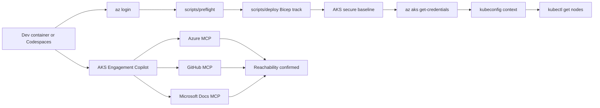

# Bootstrap architecture

The setup path moves from a prepared development environment to a validated AKS context and grounded Copilot workflow.

## Flow notes

- `scripts/preflight` catches missing access or tools before deployment.
- `scripts/deploy` provisions the secure baseline through the infrastructure contract.
- `az aks get-credentials` writes the cluster access profile into kubeconfig.
- Copilot plus MCP verification confirms that agent-assisted labs can use Azure, GitHub, and Microsoft Docs context.
