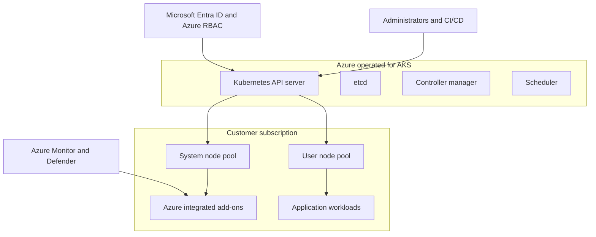

# AKS versus vanilla Kubernetes primer

Use this primer when learners need a quick comparison before exploring the cluster.

## Comparison table

| Area | Vanilla Kubernetes | Azure Kubernetes Service |
| --- | --- | --- |
| Control plane | You install, patch, scale, and back up control plane components. | Azure operates the managed control plane and exposes the Kubernetes API. |
| Worker nodes | You provision and upgrade node infrastructure. | You manage AKS node pools while Azure integrates VM scale sets and upgrade workflows. |
| Identity | You configure authentication and authorization integrations. | AKS integrates with Microsoft Entra ID, Azure RBAC, managed identities, and workload identity. |
| Networking | You choose and operate CNI, ingress, and egress patterns. | AKS supports Azure CNI Overlay, Azure load balancers, private clusters, and Azure ingress options. |
| Security posture | You assemble policy, image scanning, and threat protection. | AKS can integrate Azure Policy, Defender for Containers, Key Vault CSI, and deployment safeguards. |
| Observability | You deploy and operate metrics, logs, and dashboards. | AKS integrates Container Insights, managed Prometheus, Grafana, diagnostic settings, and Log Analytics. |
| Platform add-ons | You install and maintain add-ons manually. | AKS provides Azure-supported add-ons and managed integration points. |

## Managed control plane view

## What learners should remember

- AKS reduces operational burden for the control plane, but teams still own workload design, access decisions, node pool choices, and validation.
- Kubernetes concepts remain portable. The same namespace, Role, RoleBinding, Deployment, and Service fundamentals apply across AKS and other conformant Kubernetes platforms.
- Cross-platform readiness matters, so the certification plan includes CKA, CKAD, and OpenShift EX280 or DO280.
