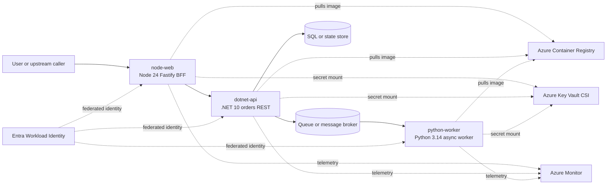

# Dependency map template

Copy this template into your evidence folder and replace the placeholders with findings from Copilot, Azure MCP, Microsoft Docs MCP, kubectl, and source review.

## Mermaid dependency map

## Service inventory

| Service | Runtime | Role | Namespace | Port(s) | Health/readiness endpoint | Evidence source |
| --- | --- | --- | --- | --- | --- | --- |
| `node-web` | Node 24 Fastify | Web BFF/front door |  |  |  |  |
| `dotnet-api` | .NET 10 ASP.NET Core Minimal API | Orders REST API |  |  | `/health` |  |
| `python-worker` | Python 3.14 FastAPI async worker | Queue consumer/metrics |  |  |  |  |

## Upstream and downstream dependencies

| Source | Target | Direction | Purpose | Criticality | Evidence source |
| --- | --- | --- | --- | --- | --- |
|  |  |  |  |  |  |

## Data flows

| Flow ID | Path | Data type | Sync/async | Protocol | Notes |
| --- | --- | --- | --- | --- | --- |
|  |  |  |  |  |  |

## Network classification

| Service | Ingress | Egress | Ports/protocols | DNS/identity dependency | Network policy status |
| --- | --- | --- | --- | --- | --- |
| `node-web` |  |  |  |  |  |
| `dotnet-api` |  |  |  |  |  |
| `python-worker` |  |  |  |  |  |

## State and persistence

| Component | State owned | Persistence service | Backup/retention expectation | Migration concern |
| --- | --- | --- | --- | --- |
| `node-web` |  |  |  |  |
| `dotnet-api` |  |  |  |  |
| `python-worker` |  |  |  |  |

## Secrets and identity

| Service | Secret/config need | Delivery mechanism | Identity used | Rotation or access concern |
| --- | --- | --- | --- | --- |
| `node-web` |  | Key Vault CSI |  |  |
| `dotnet-api` |  | Key Vault CSI |  |  |
| `python-worker` |  | Key Vault CSI |  |  |

## Open questions

- Which queue and SQL/state services are in scope for this environment?
- Which egress paths must be allowed through firewall or network policy?
- Which findings should be remediated before production cutover?
