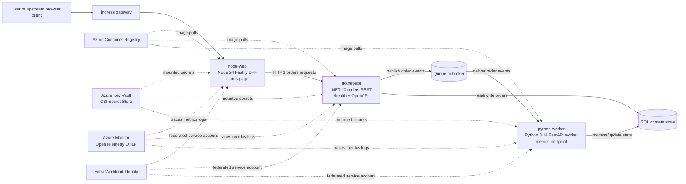

# Dependency map example

This trainer-only example shows the expected level of detail for the B.2.1 dependency map artifact.

## Mermaid dependency map

## Service inventory

| Service | Runtime | Role | Namespace | Port(s) | Health/readiness endpoint | Evidence source |
| --- | --- | --- | --- | --- | --- | --- |
| `node-web` | Node 24 Fastify | Web BFF and status page | `apps` | `8080/TCP` | Status endpoint and readiness probe | Source contract, `kubectl get svc`, Azure MCP |
| `dotnet-api` | .NET 10 ASP.NET Core Minimal API | Orders REST API | `apps` | `8080/TCP` | `/health`, OpenAPI | Source contract, `kubectl describe deploy`, Azure MCP |
| `python-worker` | Python 3.14 FastAPI async worker | Queue consumer and metrics producer | `apps` | `8000/TCP` metrics | Metrics endpoint and readiness probe | Source contract, `kubectl describe deploy`, Azure MCP |

## Upstream and downstream dependencies

| Source | Target | Direction | Purpose | Criticality | Evidence source |
| --- | --- | --- | --- | --- | --- |
| Browser or test client | `node-web` | Upstream to workload | User entry point and status page | High | Ingress/gateway routing |
| `node-web` | `dotnet-api` | Downstream | Orders API calls from BFF | High | App contract, service discovery |
| `dotnet-api` | Queue or broker | Downstream | Publish order events for async processing | High | Configuration and queue env settings |
| `dotnet-api` | SQL or state store | Downstream | Persist and read order state | High | Configuration and secret mounts |
| `python-worker` | Queue or broker | Downstream | Consume order events | High | Worker configuration |
| `python-worker` | SQL or state store | Downstream | Update processing status or derived state | Medium | Worker configuration |
| All services | ACR | Platform downstream | Pull application images | High | AKS and ACR contract |
| All services | Key Vault | Platform downstream | Mount secrets through CSI | High | SecretProviderClass and service accounts |
| All services | Azure Monitor | Platform downstream | Export OpenTelemetry traces, logs, and metrics | Medium | OpenTelemetry configuration |
| All services | Entra Workload Identity | Platform downstream | Federated identity for cloud access | High | Service account annotations |

## Data flows

| Flow ID | Path | Data type | Sync/async | Protocol | Notes |
| --- | --- | --- | --- | --- | --- |
| F1 | User → ingress gateway → `node-web` | Web request/status page | Sync | HTTP/HTTPS | External entry path; gateway policy applies. |
| F2 | `node-web` → `dotnet-api` | Order API requests and responses | Sync | HTTP/HTTPS | Requires service discovery, DNS, and network policy allowance. |
| F3 | `dotnet-api` → queue | Order event message | Async | Broker protocol or HTTPS | Queue outage creates backlog or failed order processing. |
| F4 | `python-worker` → queue | Message receive and acknowledgement | Async | Broker protocol or HTTPS | Worker scaling and retry policy affect recovery. |
| F5 | `dotnet-api` ↔ SQL/state store | Order persistence | Sync | TDS/HTTPS depending on service | Durable state requires backup and restore evidence. |
| F6 | Services → Key Vault | Secret retrieval through CSI | Sync at mount/rotation | HTTPS | Depends on workload identity and CSI driver health. |
| F7 | Services → Azure Monitor | Traces, metrics, and logs | Async export | OTLP/HTTPS | Needed for validation and operations evidence. |
| F8 | AKS nodes → ACR | Container image pull | Sync during scheduling | HTTPS | Managed identity pull permission must be intact. |

## Network classification

| Service | Ingress | Egress | Ports/protocols | DNS/identity dependency | Network policy status |
| --- | --- | --- | --- | --- | --- |
| `node-web` | Gateway or ingress to service port `8080` | `dotnet-api`, Key Vault, Azure Monitor, DNS | HTTP/HTTPS, OTLP/HTTPS | Cluster DNS, Workload Identity for Key Vault | Allow ingress from gateway; restrict egress to API and platform endpoints. |
| `dotnet-api` | `node-web` to service port `8080` | Queue, SQL/state, Key Vault, Azure Monitor, DNS | HTTP/HTTPS, broker protocol, database protocol | Cluster DNS, Workload Identity for Key Vault and data access | Allow only BFF ingress; restrict egress to queue, state, and platform endpoints. |
| `python-worker` | Metrics scrape to port `8000` | Queue, SQL/state, Key Vault, Azure Monitor, DNS | HTTP/HTTPS, broker protocol, database protocol | Cluster DNS, Workload Identity for Key Vault and data access | No user ingress; allow metrics scrape and required egress only. |

## State and persistence

| Component | State owned | Persistence service | Backup/retention expectation | Migration concern |
| --- | --- | --- | --- | --- |
| `node-web` | No durable business state; transient session/request context only | None expected | Not applicable | Confirm no sticky session or local file dependency before scaling. |
| `dotnet-api` | Orders and API transaction state | SQL or equivalent state store | Point-in-time restore, retention aligned to business requirement | Schema, connection secrets, migration window, and retry behaviour must be validated. |
| `python-worker` | Processing checkpoints or derived processing status | Queue plus SQL/state store | Queue retention, dead-letter handling, replay plan | Message idempotency and poison-message handling affect cutover risk. |
| Queue or broker | Pending order events | Managed queue or broker | Retention and dead-letter policy | Backlog size influences migration and rollback timing. |

## Secrets and identity

| Service | Secret/config need | Delivery mechanism | Identity used | Rotation or access concern |
| --- | --- | --- | --- | --- |
| `node-web` | API base URL, telemetry endpoint or credentials if required | Config plus Key Vault CSI for sensitive values | Entra Workload Identity bound to service account | Verify secrets are not plain env vars and rotation does not require pod rebuild. |
| `dotnet-api` | Queue connection, SQL/state connection, telemetry configuration | Key Vault CSI Secret Store | Entra Workload Identity bound to service account | Confirm least privilege to Key Vault, queue, and state store. |
| `python-worker` | Queue connection, state connection, telemetry configuration | Key Vault CSI Secret Store | Entra Workload Identity bound to service account | Confirm same rotation and least-privilege model as API. |
| AKS node identity | ACR pull permission | Managed identity integration | Kubelet or cluster identity | Missing `AcrPull` blocks scheduling and rollout. |

## Readiness summary

The core service topology is understandable and migration-ready once high-risk gaps are closed: network policies must reflect required flows, secrets must be delivered through Key Vault CSI, resource requests/limits and probes must be verified, and queue/state backup or replay expectations must be documented.
