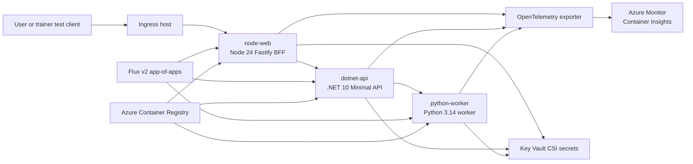
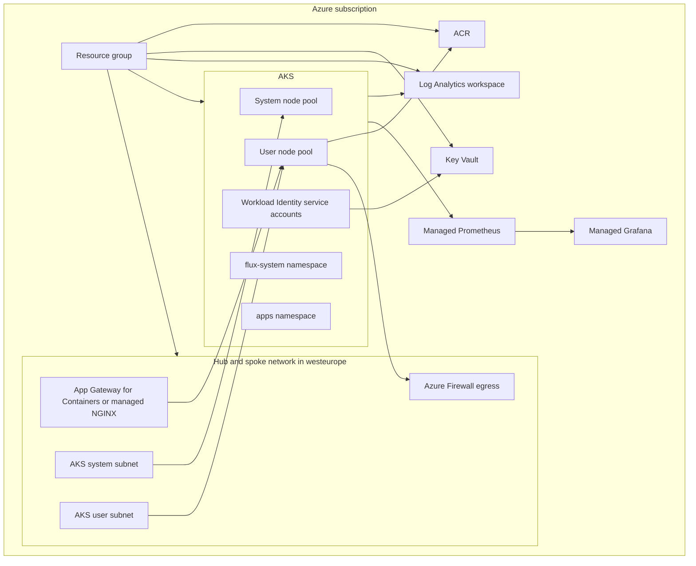
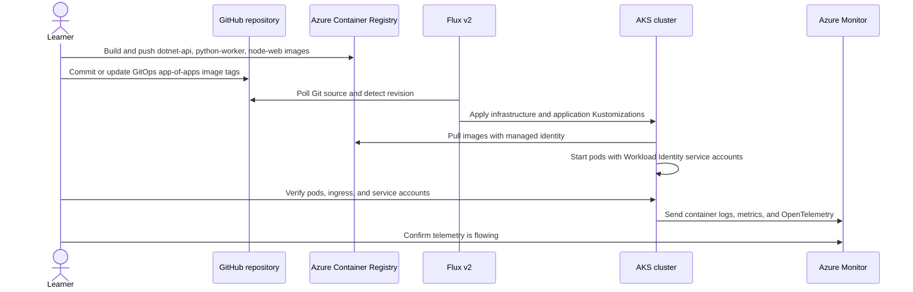

# Delivery diagrams

Use these Mermaid diagrams as the baseline structure for the B.4.1 evidence pack. Replace placeholders with deployed names during the lab.

## Logical diagram

## Physical diagram

## Sequence diagram

