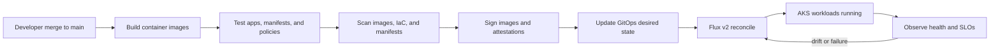

# CI/CD lifecycle

This document explains how code changes move from commit to a reconciled workload on the AKS secure baseline. It references the curriculum contracts for `apps/`, `gitops/`, and `infra/` rather than hard-coding environment-specific names.

## Scope

The lifecycle applies to the microservices in `apps/`, the Flux v2 app-of-apps desired state in `gitops/`, and the deployed AKS secure baseline from `infra/`.

Source contract links:

- `apps/`: <https://github.com/NikoMix/microhack-kubernetes-on-azure/tree/main/apps>
- `gitops/`: <https://github.com/NikoMix/microhack-kubernetes-on-azure/tree/main/gitops>
- `infra/`: <https://github.com/NikoMix/microhack-kubernetes-on-azure/tree/main/infra>

## Lifecycle narrative

1. A developer merges reviewed application or platform code to `main`.
2. CI builds distroless or chiseled container images for `dotnet-api`, `python-worker`, and `node-web`.
3. CI runs unit, integration, manifest, policy, and smoke checks appropriate to the changed component.
4. CI scans images, IaC, Helm, and Kustomize output for vulnerabilities, secrets, and policy violations.
5. CI signs images and stores attestations so deployment can verify provenance.
6. CI updates the GitOps desired state with immutable image digests and version-pinned manifests.
7. Flux v2 reconciles the `clusters/microhack/` app-of-apps configuration into AKS.
8. Azure Monitor, Container Insights, Managed Prometheus, and application health endpoints confirm the release is healthy.

## Lifecycle diagram



## Control points

| Stage | Required control | Evidence |
| --- | --- | --- |
| Build | Images are reproducible, non-root, and tagged with source metadata. | Build logs, image digest, SBOM reference. |
| Test | Application and manifest checks pass before promotion. | Test summary and deployment gate result. |
| Scan | Vulnerability, secret, IaC, and policy checks run. | Scan report and exception record if accepted. |
| Sign | Images and attestations are signed before deployment. | Signature or attestation reference for each digest. |
| Deploy | GitOps updates use immutable image digests. | Pull request, commit, Flux reconciliation event. |
| Reconcile | Flux applies desired state and reports health. | Flux Kustomization or HelmRelease status. |
| Observe | Container Insights and SLO dashboards confirm release health. | Dashboard snapshot, alert state, smoke-test result. |

## Operational checks

Use these checks during release verification. Replace placeholders with values resolved through Azure MCP or read-only Azure CLI.

```bash
az aks show --resource-group <resource-group> --name <cluster-name> --query '{name:name,kubernetesVersion:kubernetesVersion}' --output table
kubectl get kustomizations -A
kubectl get helmreleases -A
kubectl get pods -A
```

## Rollback approach

Rollback is GitOps-first. Revert the desired-state commit or promote the previous known-good image digest, then allow Flux to reconcile. Emergency manual changes must be documented, time-bound, and reconciled back into Git as soon as service impact is mitigated.
