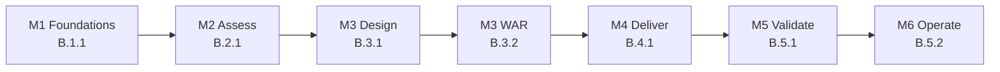

## Coverage table

| Control | Module | Lab evidence artifacts | Validation checklist location |
| --- | --- | --- | --- |
| B.1.1 | [M1 · Foundations](/modules/m1-foundations/) | Two-FTE certification mapping with named roles; readiness or study plan covering CKA, CKAD, and Red Hat OpenShift option | [M1 validation checklist](/modules/m1-foundations/#validation-checklist) |
| B.2.1 | [M2 · Assessment](/modules/m2-assessment/) | Dependency map covering upstream/downstream services, data flows, network, state, and secrets; prioritised remediation backlog with effort and risk | [M2 validation checklist](/modules/m2-assessment/#validation-checklist) |
| B.3.1 | [M3 · Design](/modules/m3-design/) | Design document and architecture diagram covering identity, networking, ingress, egress, security, observability, GitOps, data, resiliency, and cost | [M3 validation checklist](/modules/m3-design/#validation-checklist) |
| B.3.2 | [M3 · Design](/modules/m3-design/) | Reliability and Security Well-Architected Review export with pillar rationale and prioritised backlog | [M3 validation checklist](/modules/m3-design/#validation-checklist) |
| B.4.1 | [M4 · Delivery](/modules/m4-delivery/) | At least two delivery artifacts from SOW, design, project plan, architecture diagram, as-built; logical, physical, and sequence diagrams | [M4 validation checklist](/modules/m4-delivery/#validation-checklist) |
| B.5.1 | [M5 · Validate](/modules/m5-validate/) | Functional, integration, performance, resilience/chaos, and security test plan; results; performance evaluation; remediation log; customer sign-off | [M5 validation checklist](/modules/m5-validate/#validation-checklist) |
| B.5.2 | [M6 · Operate](/modules/m6-operate/) | CI/CD lifecycle document; SLO/SLA tracking; Sev1/Sev2 triage runbook; platform-currency process; growth plan; Container Insights dashboards and alerts | [M6 validation checklist](/modules/m6-operate/#validation-checklist) |

## Engagement lifecycle

## Evidence rule of thumb

Every control needs an artifact that a trainer can inspect after the lab. Screenshots and command output can support evidence, but the primary evidence is the written map, plan, design, review export, as-built, test package, or operating document named in the table.
