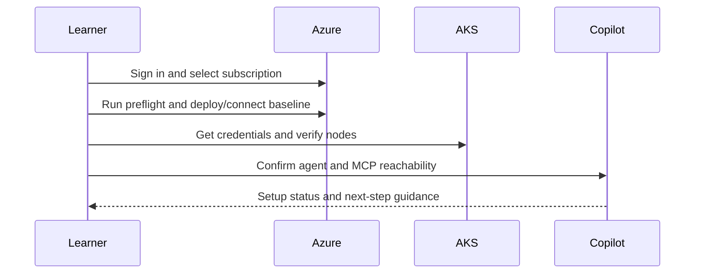

## Objective

Prepare the learner environment so the rest of the day can focus on Module B evidence instead of access or tooling issues.

## Duration

30 minutes, starting at 09:00.

## Control and evidence

| Control | Evidence |
| --- | --- |
| env | Working AKS context, reachable Azure/GitHub/Microsoft Docs MCP servers, and a responding AKS Engagement Copilot agent |

## Prerequisites

- Access to the MicroHack repository in a Codespace, dev container, or local environment.
- Azure subscription permissions for the lab resources in West Europe.
- GitHub Copilot Chat access.
- Network access to Azure, GitHub, and Microsoft Docs endpoints.

## Lab flow

1. Open the toolchain and confirm Azure CLI, kubectl, Helm, and Flux are available.
2. Sign in to Azure and select the lab subscription.
3. Run the provided preflight script to confirm quota, region, and required providers.
4. Deploy or connect to the AKS secure-baseline skeleton using the lab contract placeholders.
5. Retrieve kubeconfig and verify nodes, namespaces, and cluster identity.
6. Open the AKS Engagement Copilot and confirm Azure, GitHub, and Microsoft Docs MCP reachability.

Use the runnable steps in the [M0 lab README](https://github.com/NikoMix/microhack-kubernetes-on-azure/blob/main/challenges/00-setup/README.md). Use the [M0 facilitator guide](https://github.com/NikoMix/microhack-kubernetes-on-azure/blob/main/challenges/00-setup/facilitator.md) for timing and troubleshooting.

## Copilot and MCP usage

| Agent or server | Use in this module |
| --- | --- |
| AKS Engagement Copilot | Confirms the learner can invoke the course agent and ask setup questions |
| Azure MCP | Verifies subscription, resource group, cluster, ACR, Key Vault, and Log Analytics reachability |
| GitHub MCP | Verifies repository access for labs, slides, and GitOps source |
| Microsoft Docs MCP | Verifies live access to AKS and Kubernetes documentation |

If the agent or MCP servers are unavailable, learners continue with the manual CLI checks in the lab.

## Setup flow

## Validation checklist

| Check | Evidence tie |
| --- | --- |
| `kubectl get nodes` returns ready nodes | env: working AKS context |
| Azure MCP can inspect the lab subscription or resource group | env: reachable MCP servers |
| GitHub MCP can resolve the repository | env: reachable MCP servers |
| Microsoft Docs MCP can answer an AKS documentation query | env: reachable MCP servers |
| AKS Engagement Copilot responds to a setup prompt | env: responding course agent |

## Slides

Use the [M0 slide deck](https://github.com/NikoMix/microhack-kubernetes-on-azure/blob/main/slides/decks/01-m0-setup.md) to introduce the setup path and fallback plan.
