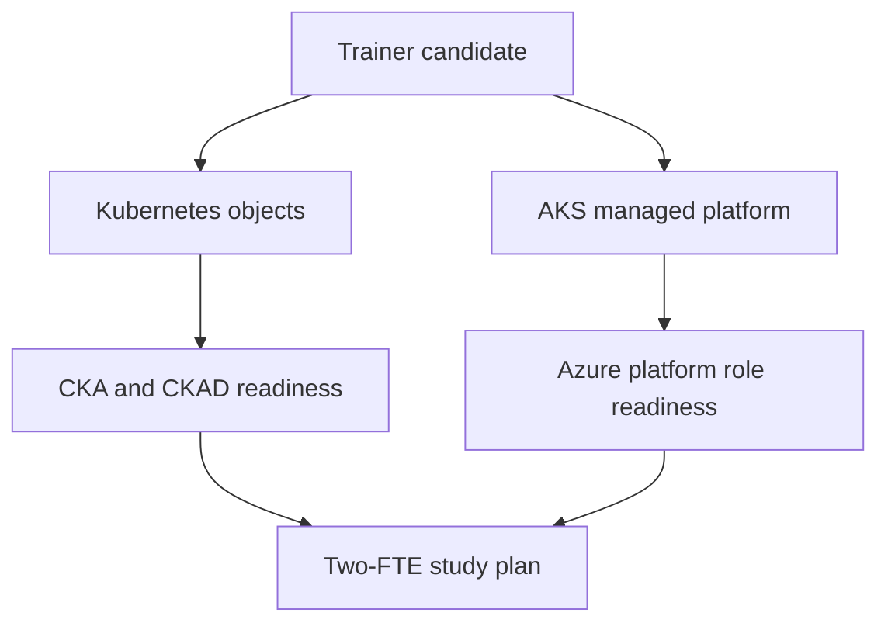

## Objective

Build shared AKS language across the cohort and produce the B.1.1 readiness evidence for two named FTEs.

## Duration

45 minutes, starting at 09:30.

## Control and evidence

| Control | Evidence |
| --- | --- |
| B.1.1 | Two-FTE certification mapping and readiness or study plan covering CKA, CKAD, and Red Hat OpenShift as the cross-platform option |

## Prerequisites

- M0 completed with a working kubeconfig context.
- `kubectl get nodes` returns ready nodes.
- Azure CLI is signed in to the lab subscription.
- AKS Engagement Copilot is reachable, with Microsoft Docs MCP connected when available.
- Newer learners have reviewed the [Kubernetes and AKS primer](/references/primer/) and [kubectl cheat sheet](/references/kubectl-cheat-sheet/).

## Lab flow

1. Compare vanilla Kubernetes responsibilities with AKS-managed responsibilities.
2. Inspect namespaces, pods, deployments, services, and RBAC bindings in the lab cluster.
3. Discuss role expectations for platform engineering and application engineering FTEs.
4. Map two named FTE roles to certification targets and study milestones.
5. Use Copilot and Microsoft Docs MCP to validate official certification objectives and fill the readiness plan.

Use the runnable steps in the [M1 lab README](https://github.com/NikoMix/microhack-kubernetes-on-azure/blob/main/challenges/01-foundations/README.md). Use the [M1 facilitator guide](https://github.com/NikoMix/microhack-kubernetes-on-azure/blob/main/challenges/01-foundations/facilitator.md) for cohort-split guidance.

## Copilot and MCP usage

| Agent or server | Use in this module |
| --- | --- |
| AKS Engagement Copilot | Answers foundation questions and helps draft the certification study plan |
| Microsoft Docs MCP | Grounds certification objectives and AKS concept explanations in official documentation |

If the skill path is unavailable, learners use the [certification map](/references/certification/) and official curriculum links manually.

## Concept bridge

## Validation checklist

| Check | Evidence tie |
| --- | --- |
| Two named FTE roles are listed | B.1.1: certification mapping |
| Each FTE has a target certification and rationale | B.1.1: certification mapping |
| Plan includes CKA or CKAD coverage and Red Hat OpenShift option | B.1.1: readiness plan |
| Study timeline includes milestones, practice labs, and assessment date | B.1.1: readiness plan |
| Trainer can explain AKS-managed versus self-managed responsibilities | B.1.1: Kubernetes foundations |

## Slides

Use the [M1 slide deck](https://github.com/NikoMix/microhack-kubernetes-on-azure/blob/main/slides/decks/02-m1-foundations.md) for the concept primer and certification discussion.
