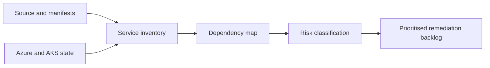

## Objective

Assess the sample workload before migration and turn discovery into B.2.1 evidence.

## Duration

60 minutes, starting at 10:15.

## Control and evidence

| Control | Evidence |
| --- | --- |
| B.2.1 | Dependency map and prioritised remediation backlog with effort and risk |

## Prerequisites

- M0 completed with Azure, AKS, repository, and MCP access.
- Access to application source contracts for `dotnet-api`, `python-worker`, and `node-web`.
- Reader access to the deployed or planned AKS environment.
- Familiarity with services, config, secrets, health checks, and network flows.

## Lab flow

1. Inventory the three application services and their runtime contracts.
2. Identify upstream and downstream dependencies, data flows, ingress, egress, state, and secrets.
3. Classify migration risks such as health probes, identity, secret handling, image hardening, and observability gaps.
4. Build a dependency map that a customer team can review.
5. Prioritise remediation backlog items by risk and effort.

Use the runnable steps in the [M2 lab README](https://github.com/NikoMix/microhack-kubernetes-on-azure/blob/main/challenges/02-assessment/README.md). Use the [M2 facilitator guide](https://github.com/NikoMix/microhack-kubernetes-on-azure/blob/main/challenges/02-assessment/facilitator.md) to keep teams focused on evidence rather than exhaustive reverse engineering.

## Copilot and MCP usage

| Skill or server | Use in this module |
| --- | --- |
| `workload-assessment` skill | Drafts dependency map and remediation backlog from prompts and inspected context |
| Azure MCP | Confirms deployed services, network dependencies, identity, and observability resources |
| Microsoft Docs MCP | Grounds remediation recommendations in AKS guidance |

If the skill is unavailable, learners fill the map and backlog manually from source review and Azure CLI output.

## Assessment model

## Validation checklist

| Check | Evidence tie |
| --- | --- |
| Map names upstream and downstream dependencies | B.2.1: dependency map |
| Map includes data flows and network paths | B.2.1: dependency map |
| Map identifies state, config, and secrets | B.2.1: dependency map |
| Backlog is prioritised with effort and risk | B.2.1: remediation backlog |
| At least one remediation item references security or reliability impact | B.2.1: remediation backlog |

## Slides

Use the [M2 slide deck](https://github.com/NikoMix/microhack-kubernetes-on-azure/blob/main/slides/decks/03-m2-assessment.md) for the discovery-to-backlog narrative.
