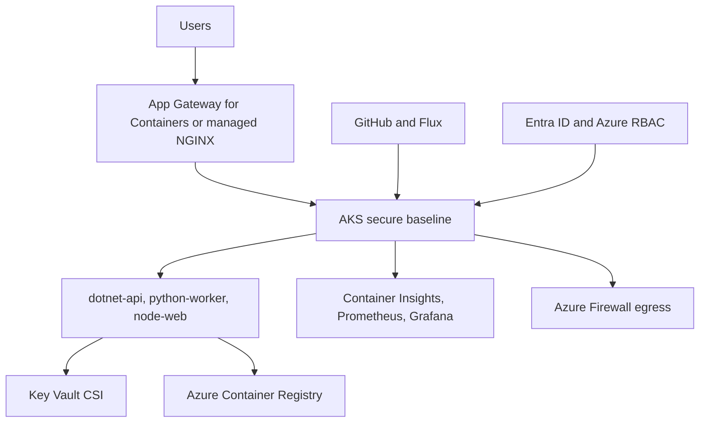

## Objective

Turn the assessment evidence into an AKS high-level design and a Reliability plus Security Well-Architected Review.

## Duration

90 minutes, starting at 11:15.

## Control and evidence

| Control | Evidence |
| --- | --- |
| B.3.1 | Design document and architecture diagram covering all required AKS design areas |
| B.3.2 | Well-Architected Review export for Reliability and Security with pillar rationale and prioritised backlog |

## Prerequisites

- M0 and M2 complete.
- Dependency map, remediation backlog, requirements, constraints, risks, and workload assumptions are available.
- Reader access to the AKS secure-baseline environment and contract outputs.
- Access to AKS Engagement Copilot with `hld-generator` and `war-runner` skills when available.

## Lab flow

1. Translate assessment findings into design decisions for identity, networking, ingress, egress, security, observability, GitOps, data, resiliency, and cost.
2. Produce a concise design document with assumptions and decisions.
3. Draw the architecture diagram for the AKS landing zone and workload path.
4. Run or manually perform the Reliability and Security Well-Architected Review.
5. Export the WAR rationale and prioritised backlog.

Use the runnable steps in the [M3 lab README](https://github.com/NikoMix/microhack-kubernetes-on-azure/blob/main/challenges/03-design/README.md). Use the [M3 facilitator guide](https://github.com/NikoMix/microhack-kubernetes-on-azure/blob/main/challenges/03-design/facilitator.md) to coach design trade-offs.

## Copilot and MCP usage

| Skill or server | Use in this module |
| --- | --- |
| `hld-generator` skill | Drafts the HLD and architecture rationale from M2 evidence |
| `war-runner` skill | Structures Reliability and Security review questions, rationale, and backlog |
| Azure MCP | Inspects baseline resources and confirms contract outputs |
| Microsoft Docs MCP | Grounds design decisions in AKS and Well-Architected guidance |

Manual fallback: use the lab templates, the assessment artifacts, and official docs to fill the HLD and WAR sections.

## Landing-zone sketch

## Validation checklist

| Check | Evidence tie |
| --- | --- |
| Design document covers every required design area | B.3.1: design document |
| Architecture diagram shows identity, network, ingress, egress, security, observability, GitOps, and workload placement | B.3.1: architecture diagram |
| WAR export includes Reliability and Security | B.3.2: WAR export |
| WAR includes pillar rationale, not just scores | B.3.2: pillar rationale |
| WAR backlog is prioritised and connected to design risks | B.3.2: prioritised backlog |

## Slides

Use the [M3 slide deck](https://github.com/NikoMix/microhack-kubernetes-on-azure/blob/main/slides/decks/04-m3-design.md) for design framing and review facilitation.
