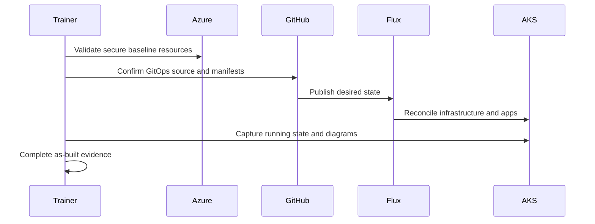

## Objective

Connect the design to delivery evidence by documenting the deployed AKS secure baseline, GitOps workload path, and customer-ready as-built narrative.

## Duration

90 minutes, starting at 13:30.

## Control and evidence

| Control | Evidence |
| --- | --- |
| B.4.1 | At least two delivery artifacts from SOW, design, project plan, architecture diagram, or as-built; plus logical, physical, and sequence diagrams |

## Prerequisites

- M3 design and WAR backlog are available.
- M0 environment remains connected to Azure and AKS.
- GitOps repository structure and app manifests are accessible.
- Learners understand the evidence threshold for B.4.1 before running delivery steps.

## Lab flow

1. Review the design decisions that must appear in delivery evidence.
2. Deploy or validate the AKS secure baseline resources from the provided contract.
3. Bootstrap or inspect Flux app-of-apps reconciliation.
4. Capture logical, physical, and sequence views of the delivered platform.
5. Produce the as-built and supporting delivery artifacts.

Use the runnable steps in the [M4 lab README](https://github.com/NikoMix/microhack-kubernetes-on-azure/blob/main/challenges/04-delivery/README.md). Use the [M4 facilitator guide](https://github.com/NikoMix/microhack-kubernetes-on-azure/blob/main/challenges/04-delivery/facilitator.md) to decide when to demo versus let learners drive.

## Copilot and MCP usage

| Skill or server | Use in this module |
| --- | --- |
| `as-built` skill | Drafts the as-built narrative and diagram descriptions from deployed state |
| Azure MCP | Confirms AKS, ACR, Key Vault, networking, observability, policy, and Defender resources |
| GitHub MCP | Confirms Flux source, manifests, and delivery history |

Manual fallback: use Azure CLI, kubectl, Flux CLI, and the provided templates to capture delivery evidence.

## Delivery sequence

## Validation checklist

| Check | Evidence tie |
| --- | --- |
| At least two accepted delivery artifacts are complete | B.4.1: SOW/design/project plan/architecture/as-built evidence |
| Logical diagram explains services and dependencies | B.4.1: logical diagram |
| Physical diagram explains Azure resources and placement | B.4.1: physical diagram |
| Sequence diagram explains delivery or deployment flow | B.4.1: sequence diagram |
| As-built aligns with the M3 design and notes deviations | B.4.1: as-built evidence |

## Slides

Use the [M4 slide deck](https://github.com/NikoMix/microhack-kubernetes-on-azure/blob/main/slides/decks/05-m4-delivery.md) for the delivery narrative.
