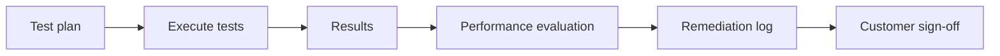

## Objective

Validate the delivered AKS workload and produce the complete B.5.1 service validation package, including customer sign-off.

## Duration

60 minutes, starting at 15:00.

## Control and evidence

| Control | Evidence |
| --- | --- |
| B.5.1 | Test plan, results, performance evaluation, remediation log, and customer sign-off |

## Prerequisites

- M4 delivery evidence is complete enough to test.
- Workloads are reachable through the intended ingress or test path.
- Observability data is available through Container Insights, logs, metrics, or dashboards.
- AKS Engagement Copilot can invoke the `test-plan` skill when available.

## Lab flow

1. Define functional, integration, performance, resilience/chaos, and security tests.
2. Execute representative tests and capture results.
3. Compare observed performance with expected thresholds.
4. Record defects and improvement items in a remediation log.
5. Prepare the customer sign-off statement as the gating evidence.

Use the runnable steps in the [M5 lab README](https://github.com/NikoMix/microhack-kubernetes-on-azure/blob/main/challenges/05-validate/README.md). Use the [M5 facilitator guide](https://github.com/NikoMix/microhack-kubernetes-on-azure/blob/main/challenges/05-validate/facilitator.md) to keep testing realistic in the one-hour slot.

## Copilot and MCP usage

| Skill or server | Use in this module |
| --- | --- |
| `test-plan` skill | Drafts the validation plan, expected results, and sign-off language |
| Azure MCP | Confirms runtime state, metrics, logs, and AKS resource configuration |
| Microsoft Docs MCP | Grounds testing and resilience recommendations in AKS guidance |

Manual fallback: use the provided test-plan template and capture CLI, dashboard, or log evidence directly.

## Validation loop

## Validation checklist

| Check | Evidence tie |
| --- | --- |
| Test plan covers functional, integration, performance, resilience/chaos, and security tests | B.5.1: test plan |
| Results are recorded with pass, fail, or blocked status | B.5.1: results |
| Performance evaluation includes threshold and observation | B.5.1: performance evaluation |
| Remediation log includes owner, priority, and next action | B.5.1: remediation log |
| Customer sign-off is explicit and references remaining risks | B.5.1: customer sign-off |

## Slides

Use the [M5 slide deck](https://github.com/NikoMix/microhack-kubernetes-on-azure/blob/main/slides/decks/06-m5-validate.md) for the testing and sign-off conversation.
