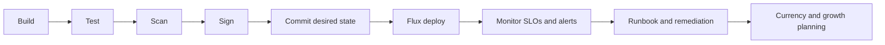

## Objective

Convert the delivered and validated AKS environment into post-deployment operating documentation for B.5.2.

## Duration

45 minutes, starting at 16:00.

## Control and evidence

| Control | Evidence |
| --- | --- |
| B.5.2 | CI/CD lifecycle document, SLO/SLA tracking, triage runbook, platform-currency process, growth plan, and Container Insights dashboards or alerts |

## Prerequisites

- M4 delivery and M5 validation evidence are available.
- Access to GitOps source, CI/CD assumptions, monitoring workspace, dashboards, and alert configuration.
- Learners understand Sev1 and Sev2 incident expectations for the platform and workload.
- AKS Engagement Copilot can invoke `runbook` and `as-built` skills when available.

## Lab flow

1. Document the CI/CD lifecycle from build through test, scan, sign, and GitOps deployment.
2. Define SLO, SLI, and SLA tracking for the service and platform.
3. Draft Sev1, Sev2, and cluster triage runbook actions.
4. Document platform-currency processes for AKS upgrades, node images, add-ons, and patches.
5. Add growth-planning signals and dashboard or alert references.

Use the runnable steps in the [M6 lab README](https://github.com/NikoMix/microhack-kubernetes-on-azure/blob/main/challenges/06-operate/README.md). Use the [M6 facilitator guide](https://github.com/NikoMix/microhack-kubernetes-on-azure/blob/main/challenges/06-operate/facilitator.md) to collect operating evidence quickly.

## Copilot and MCP usage

| Skill or server | Use in this module |
| --- | --- |
| `runbook` skill | Drafts incident triage, SLO/SLA tracking, platform currency, and growth-plan sections |
| `as-built` skill | Reuses delivered state to keep operating documents accurate |
| Azure MCP | Confirms monitoring, alerts, AKS version, node pools, add-ons, and Container Insights |
| Microsoft Docs MCP | Grounds runbook and upgrade guidance in official AKS documentation |

Manual fallback: learners fill the operating templates using M4/M5 artifacts, Azure CLI output, and docs references.

## CI/CD and operations path

## Validation checklist

| Check | Evidence tie |
| --- | --- |
| CI/CD lifecycle covers build, test, scan, sign, and GitOps deploy | B.5.2: CI/CD lifecycle doc |
| SLO/SLA tracking names signals, thresholds, and review cadence | B.5.2: SLO/SLA tracking |
| Runbook includes Sev1, Sev2, and cluster triage actions | B.5.2: triage runbook |
| Currency process covers AKS upgrades, node images, add-ons, and patches | B.5.2: platform-currency process |
| Growth plan includes capacity, cost, reliability, and observability signals | B.5.2: growth planning |
| Dashboard or alert references are captured | B.5.2: Container Insights dashboards and alerts |

## Slides

Use the [M6 slide deck](https://github.com/NikoMix/microhack-kubernetes-on-azure/blob/main/slides/decks/07-m6-operate.md) for operating model wrap-up.
