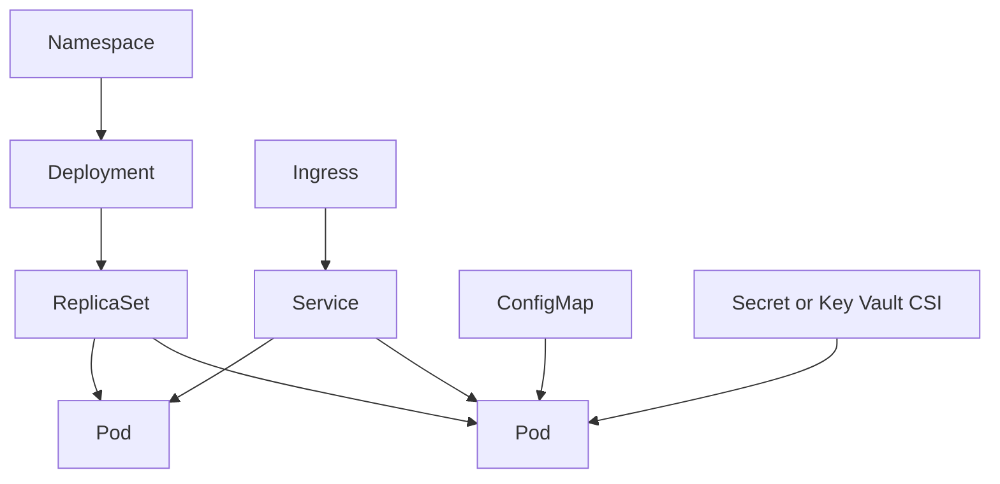

## Why Kubernetes matters in this course

Kubernetes gives you a common way to run containerised applications. AKS is Microsoft Azure's managed Kubernetes service: Azure runs much of the control-plane plumbing while you design, secure, deploy, validate, and operate the platform and workloads.

## Core objects

| Term | Plain-language meaning | Lab example |
| --- | --- | --- |
| Pod | The smallest runnable unit; usually one app container plus helper containers | A running `dotnet-api` instance |
| Deployment | Desired state for replicated pods and rolling updates | Three replicas of `node-web` |
| Service | Stable virtual IP and DNS name for pods | Internal API endpoint for the web front end |
| Namespace | Logical boundary for grouping resources | Separate `apps`, `ingress`, or `observability` areas |
| ConfigMap | Non-secret configuration | Feature flags or endpoint names |
| Secret | Sensitive configuration stored as Kubernetes secret data | A reference populated from Key Vault CSI |

## Control plane and nodes

The Kubernetes control plane stores desired state, schedules pods, and reconciles changes. Nodes run the pods. In AKS, Azure manages the control plane and integrates it with Azure identity, networking, monitoring, and upgrade operations. You still own node pools, workload configuration, policies, observability, and operational readiness.

## AKS-managed versus vanilla Kubernetes

Vanilla Kubernetes requires you to install, secure, scale, patch, and recover the control plane yourself. AKS provides a managed control plane, Azure CNI networking options, Entra ID and Azure RBAC integration, managed identities, Azure Policy for AKS, Defender for Containers, Container Insights, managed Prometheus, and Azure-native ingress, egress, and secret options.

## Ingress and egress

Ingress is traffic coming into the cluster, often through Application Gateway for Containers or managed NGINX. Egress is traffic leaving the cluster, often controlled through Azure Firewall, network policy, and explicit private endpoints. In customer engagements, always document both paths.

## RBAC basics

Kubernetes RBAC controls what users, groups, and service accounts can do inside the cluster. Azure RBAC and Entra ID can integrate with AKS so platform teams manage access using Azure identity. Use least privilege: grant the smallest role at the narrowest scope that lets the user or workload do its job.

## GitOps in one paragraph

GitOps means Git holds the desired platform and application state. Flux watches the repository, compares desired state with live cluster state, and reconciles drift. In this MicroHack, GitOps makes delivery auditable: trainers can review what changed, why it changed, and whether the cluster converged.

## Object relationship

## What to remember during labs

- Desired state lives in YAML or GitOps source.
- `kubectl` reads and changes live cluster state.
- AKS adds Azure identity, networking, security, and monitoring integrations.
- Evidence is more important than memorising commands.
