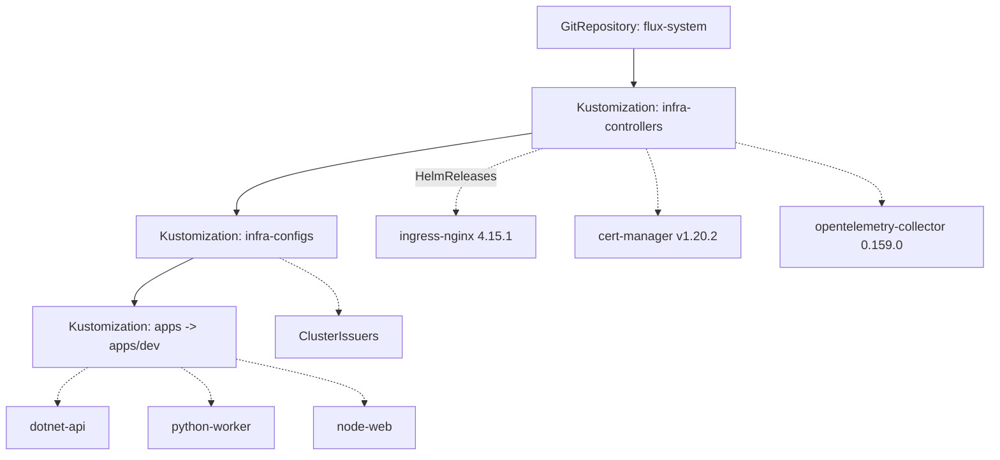

# `gitops/` — Flux v2 (app‑of‑apps)

Declarative deployment of the polyglot workloads to AKS, demonstrating the **GitOps**
delivery model required for B.4.1 / B.5.2.

## Layout
```text
gitops/
├── clusters/microhack/        # Flux Kustomizations + sources for the lab cluster
├── infrastructure/            # ingress, cert, observability add‑ons (HelmReleases)
└── apps/                      # per‑service Kustomizations (dev/prod overlays)
```

## Conventions
- App‑of‑apps pattern; environment promotion via overlays.
- Pin chart/image versions; reconcile from the repo's `main`.
- Manifests pass **kubeconform** + **kustomize build** in CI.

## Reconciliation graph



`infra-controllers` installs the platform charts (with their CRDs); `infra-configs` then adds
resources that depend on those CRDs (cert-manager `ClusterIssuer`s); `apps` deploys the
workloads last (`dependsOn` enforces ordering, `wait: true` blocks on health).

## Pinned platform versions

| Component | Kind | Chart version |
|---|---|---|
| ingress-nginx | HelmRelease | `4.15.1` |
| cert-manager | HelmRelease | `v1.20.2` |
| opentelemetry-collector | HelmRelease | `0.159.0` |

The collector publishes the in-cluster OTLP endpoint the apps export to:
`http://opentelemetry-collector.observability:4317`.

## Bootstrap

```bash
# One-time, against an AKS cluster with kubeconfig in context:
flux bootstrap github \
  --owner=NikoMix --repository=microhack-kubernetes-on-azure \
  --branch=main --path=gitops/clusters/microhack --personal
```

After bootstrap Flux reconciles `gitops/clusters/microhack` automatically. Promote to prod by
adding a Kustomization that targets `./gitops/apps/prod`.

## Validate locally (CI runs the same)

```powershell
kubectl kustomize gitops/clusters/microhack   # app-of-apps definitions
kubectl kustomize gitops/infrastructure/controllers
kubectl kustomize gitops/infrastructure/configs
kubectl kustomize gitops/apps/dev | kubeconform -strict -ignore-missing-schemas -summary
kubectl kustomize gitops/apps/prod | kubeconform -strict -ignore-missing-schemas -summary
```

`-ignore-missing-schemas` skips CRDs (Flux, cert-manager, SecretProviderClass). In CI add the
[datree CRDs-catalog](https://github.com/datreeio/CRDs-catalog) schema location to validate
those too.

> Owned by workstream **WS2 (Apps)**.
