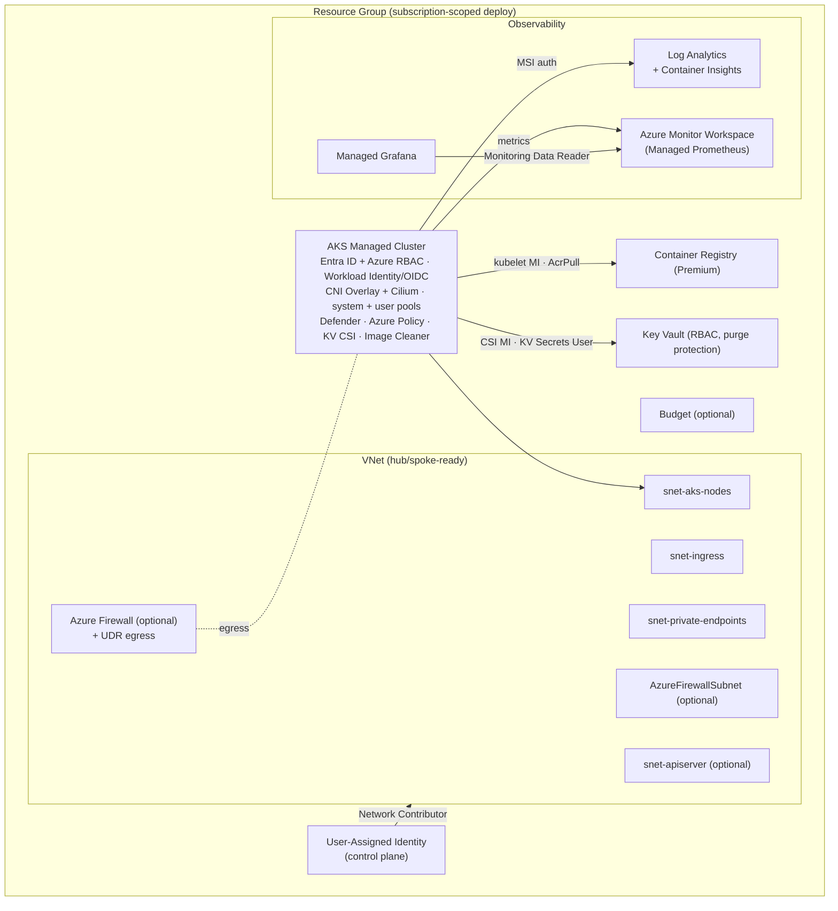

# WS1 (Infra) — AKS Secure Baseline (Bicep, AVM-first)

Bicep implementation of the MicroHack **AKS secure-baseline** landing zone. This is the
**primary** lab track; [`../terraform/`](../terraform/) is a feature-parity mirror (same root
parameters, naming, and output contract).

Built with **Azure Verified Modules (AVM)** from the public Bicep registry (`br/public:avm/res/...`)
wherever a module exists. A small number of resources without an AVM module (Managed Grafana,
Azure Monitor Workspace, Data Collection Endpoint/Rule) are authored as raw resources.

## Layout

| File | Purpose |
|---|---|
| `main.bicep` | Subscription-scoped orchestrator: creates the resource group + user-assigned identity, then wires every module and emits the output contract. |
| `main.bicepparam` | Example parameters (West Europe defaults, no secrets). Entry point for PSRule expansion. |
| `modules/network.bicep` | VNet, subnets, NSGs, optional Azure Firewall + UDR egress, Network Contributor role for the cluster identity. |
| `modules/registry.bicep` | Azure Container Registry (Premium, managed-identity pull, no anonymous/admin). |
| `modules/key-vault.bicep` | Key Vault (RBAC authorization, purge protection, soft delete, diagnostics). |
| `modules/observability.bicep` | Log Analytics + Azure Monitor Workspace + DCE/DCR (Managed Prometheus) + Managed Grafana. |
| `modules/aks.bicep` | AKS managed cluster (AVM) with the full secure-baseline configuration. |
| `modules/post-deploy.bicep` | Post-creation role assignments (kubelet→AcrPull, CSI→Key Vault Secrets User) and Prometheus DCR association. |
| `modules/budget.bicep` | Optional resource-group consumption budget with email alerts. |
| `ps-rule.yaml` | PSRule for Azure configuration (consumed by CI / WS4). |

## Architecture



## AVM modules (pinned)

| Resource | Module (`br/public:avm/res/...`) | Version |
|---|---|---|
| AKS managed cluster | `container-service/managed-cluster` | `0.13.1` |
| Container Registry | `container-registry/registry` | `0.12.1` |
| Virtual Network | `network/virtual-network` | `0.9.0` |
| Azure Firewall | `network/azure-firewall` | `0.10.1` |
| Public IP | `network/public-ip-address` | `0.12.0` |
| Network Security Group | `network/network-security-group` | `0.5.3` |
| Route Table | `network/route-table` | `0.5.0` |
| Key Vault | `key-vault/vault` | `0.13.3` |
| Log Analytics | `operational-insights/workspace` | `0.15.1` |
| User-Assigned Identity | `managed-identity/user-assigned-identity` | `0.5.1` |

**Raw resources (no AVM module available):** `Microsoft.Dashboard/grafana`,
`Microsoft.Monitor/accounts` (Azure Monitor Workspace), and
`Microsoft.Insights/dataCollectionEndpoints` + `dataCollectionRules` for Managed Prometheus.

## Parameters

All parameters have safe defaults; override per environment in `main.bicepparam`. The Terraform
track exposes the identical surface in `snake_case`.

| Group | Parameters (default) |
|---|---|
| Core | `location` (`westeurope`), `environment` (`dev`), `workloadName` (`mhaks`), `resourceGroupName` (`''` → derived), `tags` (`{}`) |
| Networking | `vnetAddressSpace` (`10.0.0.0/16`), `systemSubnetAddressPrefix` (`10.0.0.0/23`), `ingressSubnetAddressPrefix` (`10.0.4.0/24`), `privateEndpointSubnetAddressPrefix` (`10.0.5.0/24`), `firewallSubnetAddressPrefix` (`10.0.6.0/26`), `apiServerSubnetAddressPrefix` (`10.0.7.0/28`), `podCidr` (`10.244.0.0/16`), `serviceCidr` (`10.96.0.0/16`), `dnsServiceIP` (`10.96.0.10`) |
| Cluster networking | `networkDataplane` (`cilium`), `outboundType` (`loadBalancer`), `deployFirewall` (`false`), `enablePrivateCluster` (`false`), `enableApiServerVnetIntegration` (`false`), `authorizedIpRanges` (`[]`) |
| Node pools | `systemNodePoolVmSize`/`userNodePoolVmSize` (`Standard_D4ds_v5`), `systemNodePoolMinCount`/`MaxCount` (`1`/`3`), `userNodePoolMinCount`/`MaxCount` (`1`/`5`), `nodePoolAvailabilityZones` (`[1,2,3]`), `kubernetesVersion` (`''` → auto) |
| Identity & access | `adminGroupObjectIds` (`[]`), `enableAzureRbac` (`true`), `disableLocalAccounts` (`true`) |
| Add-ons / security | `enableWorkloadIdentity`, `enableKeyVaultCsi`, `enableDefenderForContainers`, `enableAzurePolicy`, `enableImageCleaner` (all `true`), `ingressType` (`managedNginx`) |
| Observability | `enableContainerInsights`, `enableManagedPrometheus`, `enableManagedGrafana` (all `true`), `grafanaAdminObjectIds` (`[]`), `logAnalyticsRetentionInDays` (`30`) |
| Registry / endpoints | `acrSku` (`Premium`), `enablePrivateEndpoints` (`false`) |
| Cost | `enableBudget` (`true`), `monthlyBudgetAmount` (`1000`), `budgetAlertEmails` (`[]`) |
| Telemetry | `enableTelemetry` (`true`) — AVM module usage telemetry |

## Outputs — the WS2/WS3/GitOps contract

`main.bicep` emits these outputs (consumed by the GitOps track and the M4 lab). The Terraform
track emits the identical set in `snake_case`.

| Output (Bicep camelCase) | Type | Description |
|---|---|---|
| `resourceGroupName` | string | Resource group name |
| `aksClusterName` | string | AKS cluster name |
| `aksClusterResourceId` | string | AKS cluster resource ID |
| `aksNodeResourceGroup` | string | Managed node resource group |
| `aksControlPlaneFqdn` | string | Control plane FQDN |
| `aksOidcIssuerUrl` | string | OIDC issuer URL (Workload Identity federation) |
| `aksKubeletIdentityObjectId` | string | Kubelet identity object ID |
| `aksKubeletIdentityClientId` | string | Kubelet identity client ID |
| `aksKubeletIdentityResourceId` | string | Kubelet identity resource ID |
| `aksClusterPrincipalId` | string | Control-plane principal ID (empty for user-assigned identity) |
| `acrName` | string | Container Registry name |
| `acrLoginServer` | string | Container Registry login server |
| `acrResourceId` | string | Container Registry resource ID |
| `keyVaultName` | string | Key Vault name |
| `keyVaultUri` | string | Key Vault URI |
| `keyVaultResourceId` | string | Key Vault resource ID |
| `logAnalyticsWorkspaceResourceId` | string | Log Analytics workspace resource ID |
| `azureMonitorWorkspaceResourceId` | string | Azure Monitor Workspace resource ID (empty if Prometheus disabled) |
| `grafanaResourceId` | string | Managed Grafana resource ID (empty if Grafana disabled) |
| `grafanaEndpoint` | string | Managed Grafana endpoint (empty if Grafana disabled) |
| `vnetResourceId` | string | VNet resource ID |
| `systemSubnetResourceId` | string | AKS node subnet resource ID |
| `ingressType` | string | Selected ingress controller type |
| `getCredentialsCommand` | string | `az aks get-credentials …` convenience command |

## Validate locally

No live deployment or Docker is required; validation is fully static.

```powershell
# From this folder. Ensure the Azure CLI Bicep is installed: az bicep install
az bicep build --file main.bicep          # restores AVM modules + full type-check
az bicep lint  --file main.bicep          # style/best-practice analyzer

# PSRule for Azure (also run in CI). Requires the standalone bicep on PATH.
Assert-PSRule -Module PSRule.Rules.Azure -InputPath .\ -Format File
```

Delete the compiled `*.json` that `az bicep build` writes next to the templates before committing.

## Deploy (reference — not run during this build)

```powershell
# Preview
az deployment sub create --location westeurope --template-file main.bicep \
  --parameters main.bicepparam --what-if
# Apply
az deployment sub create --location westeurope --template-file main.bicep \
  --parameters main.bicepparam
```

Prefer the cross-platform wrappers in [`../../scripts/`](../../scripts/) (`preflight`, `deploy`,
`cost-report`, `teardown`).

## Security posture

- Microsoft Entra ID authentication with **Azure RBAC**; **local accounts disabled**.
- **Workload Identity** + OIDC issuer for federated, secretless pod auth.
- **Azure CNI Overlay** with optional **Cilium** dataplane / network policy.
- **Microsoft Defender for Containers** (cluster profile) and **Azure Policy for AKS** add-on.
- **Key Vault CSI** with secret rotation; ACR pull via **managed identity** (no admin user).
- Key Vault **purge protection** + soft delete; ACR **anonymous pull disabled**.
- **Diagnostic settings** stream to Log Analytics across resources.

## Assumptions & integration notes

- **Defender for Containers:** this template enables the **cluster-level** profile (backed by Log
  Analytics). The **subscription-level** Defender for Containers plan (pricing) must be enabled
  separately — it is intentionally out of scope to avoid a subscription-wide billing change.
- **Ingress / App Gateway for Containers (ALB):** `ingressType` selects the contract. `managedNginx`
  enables the AKS app-routing add-on in-cluster. `appGatewayForContainers` provisions the delegated
  subnet only; the **ALB controller is installed at runtime via GitOps/Helm (WS3)**.
- **Key Vault purge protection** is on, so `teardown` leaves a **soft-deleted** vault for the
  retention window; reusing the exact name within that window requires a purge.
- **PSRule expansion limitation:** PSRule's in-memory ARM evaluator cannot mock the chained AVM
  *kubelet identity* `reference()` output, so full template expansion may stop early. This is an
  upstream tooling limitation, **not** a template defect — `az bicep build` (full AVM restore +
  type-check) and `az bicep lint` both pass. The config is provided so CI can run PSRule.
- **checkov + Bicep:** checkov's Bicep parser does not yet understand AVM registry references
  (`br/public:`) and modern syntax, so the Bicep track is covered by `az bicep build`/`lint` and
  **PSRule**; checkov fully covers the Terraform track.
- **No AI inference components** are provisioned by WS1 — the baseline is provider-agnostic
  infrastructure. Modular inference (Azure AI Foundry / Azure OpenAI / GitHub Models) is an
  application-layer concern owned by WS2 and configured against this cluster's outputs.

## Licensing

All modules are Azure Verified Modules published by Microsoft under the **MIT** license; no
third-party paid components are used.
